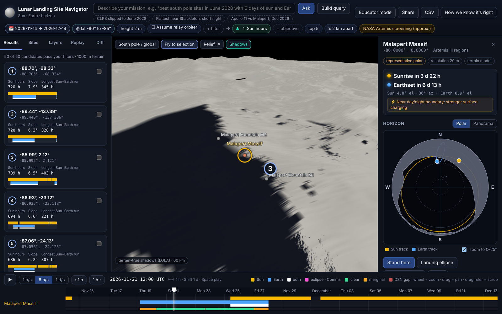
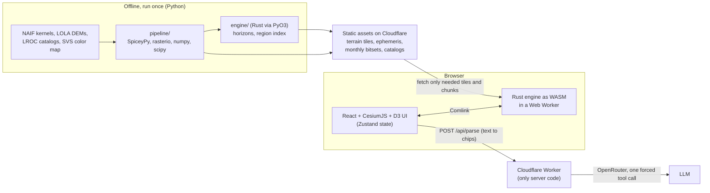

# Lunar Landing Site Navigator

*NASA Space Apps Challenge 2026 entry for the challenge "Lunar Landing Site Navigator". Not an official NASA product, and not endorsed by NASA or any space agency.*

**Which lunar sites and dates give a lander sunlight and a line of sight to Earth, and why?** Lunar Landing Site Navigator ranks sites and dates by Sun and Earth visibility measured against the real local skyline (LOLA terrain, lunar curvature, Sun-disc partial visibility, Earth eclipses of the Sun), then shows the answer on a 3D Moon with a horizon plot, a shared timeline and a first-person "stand here" view. Type a request such as "our launch slipped from March to June 2028", edit the resulting query chips, and get ranked sites in well under a second, computed in your browser from precomputed static data. The south pole, where the Sun skims the horizon and terrain decides everything, is the hard case it is built for. Apollo and other low-latitude sites are included for contrast.

<!-- TODO(verify): live demo URL and screenshot -->
**Live demo:** TODO(verify) add URL &nbsp;·&nbsp; **Video:** TODO(verify) add URL


<!-- TODO(verify): capture docs/img/screenshot.png from the final build -->

## Features

Status key: **Done** = code is in the repo and has been exercised; **In progress** = partly built; **Planned** = designed in `docs/PLAN.md`, not started. Update this table as work lands. Only rows marked Done and checked against the live build should be claimed in the submission.

| Feature | Status |
|---|---|
| **Core** | |
| Site inspector: curated catalog or any coordinate, horizon plot, Sun/Earth timeline, countdowns to sunset and Earthset | In progress (components in `web/src/components/`; TODO(verify) end to end on real data) |
| Compare 2-4 sites on one timeline | In progress (TODO(verify)) |
| Query chips: plain-language request to editable chips, then ranked sites (chips are the contract; the LLM is not in the ranking path) | In progress (`web/src/query/`, `worker/`; TODO(verify)) |
| Region ranking over the south polar 1 km grid (to 85°S) using bitset popcounts, then 20 m refinement of the top 50 | In progress (`engine/src/index.rs`, `rank.rs`; TODO(verify)) |
| 3D Moon (CesiumJS) with pins, terrain, time scrubbing, Sun/Earth placement | In progress (TODO(verify) terrain-true shadows vs Cesium built-in "approximate" shadows) |
| First-person "Stand here" view from the 720-value horizon | In progress (`FirstPerson.tsx`) |
| Landing-ellipse mode: worst/median/best over 50-200 points | In progress (`EllipsePanel.tsx`, engine) |
| Context layers: fault scarps, PSR proxy, slope, keep-out radius, day/night-boundary charging badge | In progress (faults and catalogs built; TODO(verify) other layers) |
| Metrics: sunlit hours, longest sunlit/dark run, Sun-disc fraction, Sun elevation, Earth hours, both-up hours, eclipse hours, slope, PSR and fault distance | In progress (`docs/CONTRACTS.md` section 5) |
| "How we know it's right" panel | In progress (layout exists, numbers pending; see `docs/HOW_WE_KNOW.md`) |
| Educator mode (plain labels, tooltips, guided tour) | Planned (text in `docs/EDUCATOR.md`) |
| **Extended** | |
| Shareable links (URL hash) and CSV export | In progress (`web/src/lib/share.ts`, `csv.ts`; PDF report planned) |
| Mission replay: predicted vs reported sunset for IM-1, Chandrayaan-3, SLIM, etc. | In progress (`data-src/missions.json` exists; UI and numbers TODO(verify)) |
| Scenario diff for replanning ("launch slipped N weeks") | Planned |
| Power and battery model | Planned (metric names reserved in contracts) |
| Real comms: DSN complex visibility of the Moon | In progress (`pipeline/dsn.py` built; UI TODO(verify)) |
| Rover traverse planner | Planned |
| Global (whole-Moon) region search | Planned |
| Uncertainty bands from PGDA error clones | Planned |
| Mission availability overlay; approach lighting | Planned |

## How it works



1. **Offline pipeline** (`pipeline/`) downloads NAIF kernels and LOLA DEMs once and writes browser-ready static files under 25 MiB each: terrain tile pyramids, a 15-minute Sun/Earth ephemeris (2026-2030), monthly Sun-up/Earth-up bitsets for the south polar grid, and site, mission and fault catalogs.
2. **One Rust engine** (`engine/`) is compiled twice: natively (PyO3, used by the pipeline to build the index) and to WebAssembly (wasm-bindgen, rayon threads where cross-origin isolation allows). Precompute and browser share the same code.
3. **Per site and time**: Sun and Earth direction in the Moon's mean-Earth frame (SPICE, DE440) is rotated into the site's local east-north-up frame. The terrain horizon is ray-marched from LOLA (finest DEM near, coarser far) with a curvature term. The Sun is visible in proportion to how much of its 0.53° disc clears the horizon. Earth counts as up when its centre clears the horizon. Eclipses of the Sun by Earth are handled in the ephemeris step.
4. **Ranking**: filters first, then lexicographic (or weighted) sort over ordered objectives, spatial de-duplication, and a refine pass at full resolution.
5. **No application server.** The only server code is one small Worker that forwards typed requests to an LLM through OpenRouter and returns validated query JSON. A form UI builds the same JSON, so everything works with the LLM off.

Every result carries the resolution used and a model label. Limits and assumptions are listed in [`docs/HOW_WE_KNOW.md`](docs/HOW_WE_KNOW.md). Architecture and file formats: [`docs/CONTRACTS.md`](docs/CONTRACTS.md). Product plan: [`docs/PLAN.md`](docs/PLAN.md).

## Data sources and citations

Coordinates are planetocentric, east-positive, in the Moon mean-Earth/polar-axis frame. Full retrieval notes and links: [`data-src/SOURCES.md`](data-src/SOURCES.md).

| Data | Used for | Citation |
|---|---|---|
| LRO LOLA gridded DEMs: LDEM_85S_20M, LDEM_80S_80M, LDEM_60S_240M (polar); LDEM_64, LDEM_16, LDEM_4 (global). [PDS Geosciences Node](https://pds-geosciences.wustl.edu/lro/lro-l-lola-3-rdr-v1/lrolol_1xxx/data/lola_gdr/) | Terrain, horizons, slope | Smith, D. E., et al. (2010). Initial observations from the Lunar Orbiter Laser Altimeter (LOLA). *Geophys. Res. Lett.*, 37, L18204. https://doi.org/10.1029/2010GL043751 ; Smith, D. E., et al. (2017). Summary of the results from the Lunar Orbiter Laser Altimeter after seven years in lunar orbit. *Icarus*, 283, 70-91. https://doi.org/10.1016/j.icarus.2016.06.006 |
| NAIF SPICE toolkit and generic kernels (`naif0012.tls`, `de440s.bsp`, `moon_pa_de440_200625.bpc`, `moon_de440_250416.tf`, `pck00011.tpc`, `gm_de440.tpc`, DSN station kernels). https://naif.jpl.nasa.gov/naif/data_generic.html | Sun/Earth geometry, frames, DSN | Acton, C. H. (1996). Ancillary data services of NASA's Navigation and Ancillary Information Facility. *Planet. Space Sci.*, 44(1), 65-70. https://doi.org/10.1016/0032-0633(95)00107-7 ; Acton, C., et al. (2018). A look towards the future in the handling of space science mission geometry. *Planet. Space Sci.*, 150, 9-12. https://doi.org/10.1016/j.pss.2017.02.013 |
| JPL planetary ephemeris DE440 (DE441 inside Horizons) | Positions of Sun, Earth, Moon | Park, R. S., et al. (2021). The JPL Planetary and Lunar Ephemerides DE440 and DE441. *Astron. J.*, 161, 105. https://doi.org/10.3847/1538-3881/abd414 |
| JPL Horizons, https://ssd.jpl.nasa.gov/horizons/ | Independent validation only | Giorgini, J. D., et al. (1996). JPL's on-line solar system data service. *Bull. Am. Astron. Soc.*, 28(3), 1158. |
| PGDA lunar polar illumination, https://pgda.gsfc.nasa.gov/products/69 | Planned validation of average illumination (TODO(verify) whether done); region and analysis background | Mazarico, E., Neumann, G. A., Smith, D. E., Zuber, M. T., & Torrence, M. H. (2011). Illumination conditions of the lunar polar regions using LOLA topography. *Icarus*, 211(2), 1066-1081. https://doi.org/10.1016/j.icarus.2010.10.030 |
| LROC lobate scarps (60S-60N), 842 polylines | Fault layer | Nelson, D. M., Koeber, S. D., Daud, K., Robinson, M. S., Watters, T. R., Banks, M. E., & Williams, N. R. (2014). Mapping lunar maria extents and lobate scarps using LROC image products. *LPSC 45*, abstract 2861. |
| LROC polar lobate scarp locations (+/-65-90°), 48 points | Fault layer, poles | Watters, T. R., et al. (2015). Global thrust faulting on the Moon and the influence of tidal stresses. *Geology*, 43(10), 851-854. https://doi.org/10.1130/G37120.1 |
| LROC anthropogenic features shapefile | Lander coordinates | Wagner, R. V., et al. (2017). Coordinates of anthropogenic features on the Moon. *Icarus*, 283, 92-103. https://doi.org/10.1016/j.icarus.2016.05.011 |
| Diviner (LRO) temperatures | Temperature layer, **not yet used**; TODO(verify) before claiming | Paige, D. A., et al. (2010). The Lunar Reconnaissance Orbiter Diviner Lunar Radiometer Experiment. *Space Sci. Rev.*, 150, 125-160. https://doi.org/10.1007/s11214-009-9529-2 ; Williams, J.-P., et al. (2019). Seasonal polar temperatures on the Moon. *J. Geophys. Res. Planets*, 124, 2505-2521. https://doi.org/10.1029/2019JE006028 |
| NASA SVS CGI Moon Kit (SVS 4720), LROC color map | Globe imagery (visual only, not for measurement). https://svs.gsfc.nasa.gov/4720 | NASA Scientific Visualization Studio. TODO(verify) exact credit line from the SVS page |
| Barker et al. (2016, 2021) LOLA/SLDEM and 5 m polar DEMs | **Not used** in the current terrain pipeline; cited as the route to finer terrain and DEM error estimates (Barker et al. 2021, *Planet. Space Sci.*, 203, 105119, https://doi.org/10.1016/j.pss.2020.105119) | Include in references only if the 5 m DEMs get used |

Artemis region points are **representative points** chosen by us (NASA publishes no coordinates); see `data-src/SOURCES.md` for how each was derived. Mission and site catalogs list a source link per entry.

## Local development

Needs: Python 3.11+ with [uv](https://docs.astral.sh/uv/), Rust with the `wasm32-unknown-unknown` target, `wasm-pack`, Node.js and npm.

```bash
# 1. Offline pipeline, from pipeline/ (idempotent, ~1.4 GB of downloads)
cd pipeline
uv run python fetch.py        # NAIF kernels, LOLA DEMs, SVS color map
uv run python ephem.py        # ephemeris 2026-2030
uv run python tiles.py        # terrain tile pyramid
uv run python imagery.py      # globe color tiles
uv run python dsn.py          # DSN Moon elevation
uv run python index.py        # region index (needs the native engine as the `lunar_engine` Python module)
uv run python validate_ephem.py   # check vs JPL Horizons (needs network)
# pipeline/run_all.sh runs these in order (referenced by CI; TODO(verify) it exists in the final repo)
# Output goes to web/public/data/ (git-ignored)

# 2. Engine to WASM, then the web app
scripts/build-wasm.sh         # writes web/src/engine/pkg
cd web && npm ci && npm run dev   # dev server
# or the full production build: scripts/build.sh

# 3. Tests
cd web && npm test            # query parsing/validation tests
cd engine && cargo test       # engine unit tests; TODO(verify) feature flags needed
```

`TODO(verify)`: building the native Python module for `index.py` (PyO3, e.g. via maturin using `engine/pyproject.toml`) needs the exact command confirmed.

## Repository layout

```
engine/      Rust crate: horizons, visibility, metrics, region index, ranking (native + PyO3 + WASM)
pipeline/    Offline Python pipeline and numpy reference implementations (reference/)
data-src/    Hand-curated catalogs: sites.json, missions.json, faults.geojson, SOURCES.md
web/         Vite + React + TypeScript app; web/public/data/ is generated output
worker/      Cloudflare Worker: static assets and POST /api/parse
docs/        PLAN, CONTRACTS, VALIDATION, HOW_WE_KNOW, EDUCATOR, SUBMISSION, VIDEO
scripts/     Build and data packaging scripts
```

## License

MIT. See [`LICENSE`](LICENSE). NASA data products keep their own terms; third-party libraries keep theirs.

## Acknowledgements

Thanks to the teams behind LRO and LOLA, LROC, NAIF/SPICE, JPL Horizons, the Planetary Geodynamics Data Archive, NASA SVS and the PDS, whose open data make this possible, and to NASA Space Apps organizers. Existing tools such as LROC QuickMap and NASA Moon Trek were used as references for sanity checks. This project is independent and is not endorsed by NASA.

## AI tools used

- **Claude Code** (Anthropic) was used throughout development to write and review code, scripts and documentation. All AI-written code and text was reviewed by the team. TODO(verify) team to confirm wording.
- **An LLM via OpenRouter** is used at runtime for one purpose only: turning a typed request into editable query chips (`POST /api/parse`, one forced tool call, output validated against the query schema). It is never in the ranking or metric path, writes no explanations, and the app works without it through the form UI. Model id: TODO(verify) (set by the `PARSE_MODEL` variable).
- No generative AI was used to make imagery or data.


## Deploy

One Cloudflare Worker (`worker/`, config in `wrangler.toml`) serves the built web app
(`web/dist/`) as static assets and handles `POST /api/parse` (natural-language query
parsing via OpenRouter) and `GET /api/health`.

**Data** (`web/public/data/`, ~1 GB) is not in git and is generated in CI by
`pipeline/run_all.sh` (idempotent; skips steps whose outputs exist). The deploy workflow caches
`pipeline/raw/` (keyed on `pipeline/fetch.py`) and `web/public/data/` (keyed on the pipeline,
engine and `data-src/` sources), so only the first run, or a run after those sources change,
is slow. The release-based scripts `scripts/package-data.sh` and `scripts/fetch-data.sh`
(tarball parts on a `data-latest` release) remain in the repo but CI does not use them.

**Build:** `scripts/build.sh` (wasm-pack build of `engine/`, then `npm ci && npm run build`
in `web/`; `SKIP_WASM=1` skips the wasm step).

**CI:** `.github/workflows/deploy.yml` runs on push to `main` (and manually): run the data pipeline (cached), build, deploy with `cloudflare/wrangler-action`. Required repo secrets: `CLOUDFLARE_API_TOKEN`
(Workers edit permission), `CLOUDFLARE_ACCOUNT_ID`, `OPENROUTER_API_KEY`. Without
`CLOUDFLARE_API_TOKEN` the deploy step is skipped with a notice. `pr-build.yml` builds
without data on pull requests.

**Local Worker test:** from `worker/`, `npm install`, then `npm run dev` (needs `web/dist/`).
Offline: `npx wrangler dev --config ../wrangler.toml --var PARSE_MOCK:1`. Real model: put
`OPENROUTER_API_KEY=...` in `.dev.vars` at the repo root (git-ignored) and run `npm run dev`.
