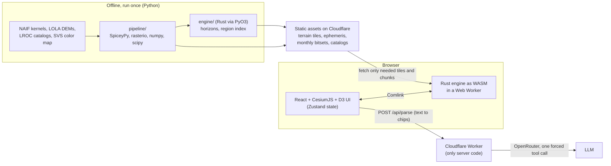

# Lunar Landing Site Navigator

*NASA Space Apps Challenge 2026 entry for the challenge "Lunar Landing Site Navigator". Not an official NASA product, and not endorsed by NASA or any space agency.*

**Lunar Landing Site Navigator shows which lunar sites and dates give a lander sunlight and a line of sight to Earth, and why, using the real local skyline.**

**Try it:** Open the live demo and click *Launch slips to June 2028* on the welcome card, then *Compare with Mar 1 – Mar 31, 2028* above the results.

Why trust it (details in [`docs/VALIDATION.md`](docs/VALIDATION.md)):

- **r = 0.976** between our sunlit fraction and NASA PGDA average illumination over 72,324 one-km cells at 85-90°S.
- **IoU 0.81** between our "never lit" cells and the published permanent-shadow mask (97.7% of cells agree).
- **Mission replay is consistent with real landers:** Chandrayaan-3 and Blue Ghost 1 shut down within 4 h of our predicted sunset (+3.6 h, -3.4 h). This is a consistency check, not a sunset test; IM-1 tipped and ended early, and SLIM, IM-2 and Hakuto-R M2 ended in landing anomalies, so they are not compared.

**Live demo:** https://lunar-site-navigator.cutenitki.workers.dev &nbsp;·&nbsp; **Repository:** https://github.com/rairai77/NASA-2026 (MIT)


## What it does

It ranks sites and dates by Sun and Earth visibility measured against the real local skyline (LOLA terrain, lunar curvature, Sun-disc partial visibility, Earth eclipses of the Sun), then shows the answer on a 3D Moon with a horizon plot, a shared timeline and a first-person "stand here" view. Type a request such as "our launch slipped from March to June 2028", edit the resulting query chips, and get ranked sites computed in your browser from precomputed static data. The south pole, where the Sun skims the horizon and terrain decides everything, is the hard case it is built for. Apollo and other low-latitude sites are included for contrast. Performance example: a 4-month lat-lon box query ranks 64,800 cells in 0.59 s and refines 50 candidates in 0.14 s (WASM, Node; see `docs/VALIDATION.md`).

## Features

Status key: **Done** = code is in the repo and wired into the app; **Not built** = designed in `docs/PLAN.md`, no code. Measured results for the engine and data are in `docs/VALIDATION.md`.

| Feature | Status |
|---|---|
| **Core** | |
| Site inspector: curated catalog or any coordinate, horizon plot, Sun/Earth timeline, countdowns to sunset and Earthset | Done (`web/src/components/Drawer.tsx`, `HorizonPlot.tsx`, `Timeline.tsx`, `web/src/lib/countdown.ts`) |
| Compare 2-4 sites on one timeline | Done (`web/src/components/Timeline.tsx`, `MAX_COMPARE` in `web/src/store.ts`) |
| Query chips: plain-language request to editable chips, then ranked sites (chips are the contract; the LLM is not in the ranking path) | Done (`web/src/components/QueryBar.tsx`, `web/src/query/`, `worker/src/`) |
| Polar region ranking: 1 km grid to 85°S, coarse bitset pass, then 15-minute refine of the top 50 | Done (`engine/src/index.rs`, `engine/src/rank.rs`) |
| Whole-Moon and lat-lon box screening on a ~10 km global grid, flagged "coarse" in the UI | Done (`engine/src/global.rs`, `pipeline/global_index.py`, `QueryBar.tsx`) |
| 3D Moon (CesiumJS) with LOLA terrain, pins, time scrubbing and terrain-true shadow patches computed by the engine (60 km local patch at about 29 m/px, 650 km regional patch) | Done (`web/src/globe/Globe.tsx`, `shadowProvider.ts`, `engine/src/patch.rs`) |
| First-person "Stand here" view from the 720-value horizon | Done (`web/src/components/FirstPerson.tsx`) |
| Landing-ellipse mode: worst, median and best case over 10 to 400 sample points (default 100) | Done (`web/src/components/EllipsePanel.tsx`, `engine/src/engine.rs`) |
| Context layers: PGDA permanently shadowed regions, PGDA average illumination, PGDA average Earth visibility, Diviner annual maximum surface and average (2 cm) temperature, fault scarps, keep-out circles | Done (`pipeline/layers.py`, `web/public/data/layers/manifest.json`, `web/src/components/LeftPanel.tsx`) |
| Charging badge near the day/night boundary (a caution, not a measured value) | Done (`web/src/components/Drawer.tsx`) |
| Metrics: sunlit hours, longest sunlit/dark run, Sun-disc fraction, Sun elevation, Earth hours, both-up hours, eclipse hours, slope, elevation, PSR and fault distance | Done (`web/src/query/metrics.ts`, `engine/src/metrics.rs`) |
| "How we know it's right" modal with real numbers | Done (`web/src/components/ValidationModal.tsx`, `web/src/lib/validationText.ts`) |
| Educator mode (plain labels, tooltips) and 5-step guided tour | Done (`web/src/lib/educatorText.ts`, `web/src/components/Tour.tsx`) |
| **Extended** | |
| Shareable links (URL hash) and CSV export | Done (`web/src/lib/share.ts`, `web/src/lib/csv.ts`) |
| Mission replay: predicted vs reported local sunset | Done (`web/src/components/ReplayTab.tsx`, `pipeline/missions_pred.py`) |
| Scenario diff for replanning ("launch slipped N weeks") | Done (`web/src/components/DiffTab.tsx`) |
| Power and battery model: panel card, `energy_wh` and `battery_wh_needed` usable in queries | Done (`web/src/components/PowerPanel.tsx`, `engine/src/power.rs`) |
| Real comms: DSN complex visibility, link-margin lane, comms metrics, relay toggle | Done (`pipeline/dsn.py`, `engine/src/comms.rs`, `web/src/components/Timeline.tsx`, `QueryBar.tsx`) |
| Rover traverse planner: A* with a slope limit, waits for sunlight | Done (`engine/src/traverse.rs`, `web/src/components/TraversePanel.tsx`, `web/src/globe/traverseLayer.ts`) |
| Uncertainty bands from PGDA error clones | Not built |
| PDF report | Not built |
| Mission availability overlay | Not built |
| Approach lighting | Not built |

## How it works



1. **Offline pipeline** (`pipeline/`) downloads NAIF kernels and LOLA DEMs once and writes browser-ready static files under 25 MiB each: terrain tile pyramids, a 15-minute Sun/Earth ephemeris (2026-2030), monthly Sun-up/Earth-up bitsets for the south polar grid, and site, mission and fault catalogs.
2. **One Rust engine** (`engine/`) is compiled twice: natively (PyO3, used by the pipeline to build the index) and to WebAssembly (wasm-bindgen, rayon threads where cross-origin isolation allows). Precompute and browser share the same code.
3. **Per site and time**: Sun and Earth direction in the Moon's mean-Earth frame (SPICE, DE440) is rotated into the site's local east-north-up frame. The terrain horizon is ray-marched from LOLA (finest DEM near, coarser far) with a curvature term. The Sun is visible in proportion to how much of its 0.53° disc clears the horizon. Earth counts as up when its centre clears the horizon. Eclipses of the Sun by Earth are handled in the ephemeris step.
4. **Ranking**: filters first, then lexicographic (or weighted) sort over ordered objectives, spatial de-duplication, and a refine pass of the top 50 candidates at 15-minute steps with full-resolution terrain. Outside the pole, a coarse index on a ~10 km global grid is used and results are flagged "coarse".
5. **No application server.** The only server code is one small Worker that forwards typed requests to an LLM through OpenRouter and returns validated query JSON. A form UI builds the same JSON, so everything works with the LLM off.

Every result carries the resolution used and a model label. Limits and assumptions are listed in [`docs/HOW_WE_KNOW.md`](docs/HOW_WE_KNOW.md). Architecture and file formats: [`docs/CONTRACTS.md`](docs/CONTRACTS.md). Product plan: [`docs/PLAN.md`](docs/PLAN.md).

## Data sources and citations

Coordinates are planetocentric, east-positive, in the Moon mean-Earth/polar-axis frame. Full retrieval notes and links: [`data-src/SOURCES.md`](data-src/SOURCES.md).

| Data | Used for | Citation |
|---|---|---|
| LRO LOLA gridded DEMs: LDEM_85S_20M, LDEM_80S_80M, LDEM_60S_240M (polar); LDEM_64, LDEM_16, LDEM_4 (global). [PDS Geosciences Node](https://pds-geosciences.wustl.edu/lro/lro-l-lola-3-rdr-v1/lrolol_1xxx/data/lola_gdr/) | Terrain, horizons, slope | Smith, D. E., et al. (2010). Initial observations from the Lunar Orbiter Laser Altimeter (LOLA). *Geophys. Res. Lett.*, 37, L18204. https://doi.org/10.1029/2010GL043751 ; Smith, D. E., et al. (2017). Summary of the results from the Lunar Orbiter Laser Altimeter after seven years in lunar orbit. *Icarus*, 283, 70-91. https://doi.org/10.1016/j.icarus.2016.06.006 |
| NAIF SPICE toolkit and generic kernels (`naif0012.tls`, `de440s.bsp`, `moon_pa_de440_200625.bpc`, `moon_de440_250416.tf`, `pck00011.tpc`, `gm_de440.tpc`, DSN station kernels). https://naif.jpl.nasa.gov/naif/data_generic.html | Sun/Earth geometry, frames, DSN | Acton, C. H. (1996). Ancillary data services of NASA's Navigation and Ancillary Information Facility. *Planet. Space Sci.*, 44(1), 65-70. https://doi.org/10.1016/0032-0633(95)00107-7 ; Acton, C., et al. (2018). A look towards the future in the handling of space science mission geometry. *Planet. Space Sci.*, 150, 9-12. https://doi.org/10.1016/j.pss.2017.02.013 |
| JPL planetary ephemeris DE440 (DE441 inside Horizons) | Positions of Sun, Earth, Moon | Park, R. S., et al. (2021). The JPL Planetary and Lunar Ephemerides DE440 and DE441. *Astron. J.*, 161, 105. https://doi.org/10.3847/1538-3881/abd414 |
| JPL Horizons, https://ssd.jpl.nasa.gov/horizons/ | Independent validation only | Giorgini, J. D., et al. (1996). JPL's on-line solar system data service. *Bull. Am. Astron. Soc.*, 28(3), 1158. |
| PGDA lunar polar illumination, https://pgda.gsfc.nasa.gov/products/69 | Validation of our sunlit and Earth-up fractions and permanent-shadow proxy (`pipeline/validate_pgda.py`); globe layers for permanent shadow, average illumination and average Earth visibility | Mazarico, E., Neumann, G. A., Smith, D. E., Zuber, M. T., & Torrence, M. H. (2011). Illumination conditions of the lunar polar regions using LOLA topography. *Icarus*, 211(2), 1066-1081. https://doi.org/10.1016/j.icarus.2010.10.030 |
| LROC lobate scarps (60S-60N), 842 polylines | Fault layer | Nelson, D. M., Koeber, S. D., Daud, K., Robinson, M. S., Watters, T. R., Banks, M. E., & Williams, N. R. (2014). Mapping lunar maria extents and lobate scarps using LROC image products. *LPSC 45*, abstract 2861. |
| LROC polar lobate scarp locations (+/-65-90°), 48 points | Fault layer, poles | Watters, T. R., et al. (2015). Global thrust faulting on the Moon and the influence of tidal stresses. *Geology*, 43(10), 851-854. https://doi.org/10.1130/G37120.1 |
| LROC anthropogenic features shapefile | Lander coordinates | Wagner, R. V., et al. (2017). Coordinates of anthropogenic features on the Moon. *Icarus*, 283, 92-103. https://doi.org/10.1016/j.icarus.2016.05.011 |
| LRO Diviner Polar Resource Product (annual maximum surface and average 2 cm temperature, 75-90°S) | Temperature layers on the globe (`pipeline/layers.py`) | Paige, D. A., et al. (2010). The Lunar Reconnaissance Orbiter Diviner Lunar Radiometer Experiment. *Space Sci. Rev.*, 150, 125-160. https://doi.org/10.1007/s11214-009-9529-2 ; Williams, J.-P., et al. (2019). Seasonal polar temperatures on the Moon. *J. Geophys. Res. Planets*, 124, 2505-2521. https://doi.org/10.1029/2019JE006028 |
| NASA SVS CGI Moon Kit (SVS 4720), LROC color map | Globe imagery (visual only, not for measurement). https://svs.gsfc.nasa.gov/4720 | NASA's Scientific Visualization Studio (visualizer Ernie Wright, scientist Noah Petro), from LRO LOLA and LROC WAC data. SVS notes the color maps are optimised for appearance, not science. |
| LRO NAC polar average mosaics (1 m/px) and LROC WAC global mosaic (~100 m/px), served by [NASA Moon Trek](https://trek.nasa.gov) | Globe imagery when zoomed in (visual only, not for measurement), streamed from trek.nasa.gov and reprojected in the browser | NASA/GSFC/Arizona State University (LROC). |
| Barker et al. (2016, 2021) LOLA/SLDEM and 5 m polar DEMs | **Not used** in the current terrain pipeline; cited as the route to finer terrain and DEM error estimates (Barker et al. 2021, *Planet. Space Sci.*, 203, 105119, https://doi.org/10.1016/j.pss.2020.105119) | Not cited as a data source |

Artemis region points are **representative points** chosen by us (NASA publishes no coordinates); see `data-src/SOURCES.md` for how each was derived. Mission and site catalogs list a source link per entry.

## Local development

Needs: Python 3.11+ with [uv](https://docs.astral.sh/uv/), Rust with the `wasm32-unknown-unknown` target, `wasm-pack`, Node.js and npm.

```bash
# 1. Offline pipeline, from pipeline/ (idempotent, ~1.4 GB of downloads)
cd pipeline
uv run python fetch.py        # NAIF kernels, LOLA DEMs, SVS color map
uv run python ephem.py        # ephemeris 2026-2030
uv run python tiles.py        # terrain tile pyramid
uv run python imagery.py      # globe color tiles
uv run python dsn.py          # DSN Moon elevation
uv run python index.py        # polar region index (needs the native engine as the `lunar_engine` Python module)
uv run python global_index.py # ~10 km whole-Moon index
uv run python curated.py && uv run python missions_pred.py   # curated site metrics, mission replay predictions
uv run python validate_pgda.py --fetch && uv run python layers.py   # PGDA comparison and globe layers
uv run python copy_catalogs.py
uv run python validate_ephem.py   # check vs JPL Horizons (needs network)
# pipeline/run_all.sh runs these in order and is what CI runs (it also builds the native engine, see below)
# Output goes to web/public/data/ (git-ignored)

# 2. Engine to WASM, then the web app
scripts/build-wasm.sh         # writes web/src/engine/pkg
cd web && npm ci && npm run dev   # dev server
# or the full production build: scripts/build.sh

# 3. Tests
cd web && npm test            # query parsing/validation tests (node --test on web/src/query/*.test.ts)
cd worker && npm test         # worker request validation tests
cd engine && cargo test --release   # engine unit tests, default features
```

The native Python module that `index.py` imports (`lunar_engine`) is built with maturin and installed into the pipeline venv. `pipeline/run_all.sh` does this in `build_engine`:

```bash
uvx maturin build --release -m engine/Cargo.toml --out pipeline/work/wheels
uv pip install --python pipeline/.venv/bin/python --force-reinstall --no-deps pipeline/work/wheels/lunar_engine-*.whl
```

## Repository layout

```
engine/      Rust crate: horizons, visibility, metrics, region index, ranking (native + PyO3 + WASM)
pipeline/    Offline Python pipeline and numpy reference implementations (reference/)
data-src/    Hand-curated catalogs: sites.json, missions.json, faults.geojson, SOURCES.md
web/         Vite + React + TypeScript app; web/public/data/ is generated output
worker/      Cloudflare Worker: static assets and POST /api/parse
docs/        PLAN, CONTRACTS, VALIDATION, HOW_WE_KNOW, EDUCATOR, SUBMISSION, VIDEO
scripts/     Build and data packaging scripts
```

## License

MIT. See [`LICENSE`](LICENSE). NASA data products keep their own terms; third-party libraries keep theirs.

## Acknowledgements

Thanks to the teams behind LRO and LOLA, LROC, NAIF/SPICE, JPL Horizons, the Planetary Geodynamics Data Archive, NASA SVS and the PDS, whose open data make this possible, and to NASA Space Apps organizers. Existing tools such as LROC QuickMap and NASA Moon Trek were used as references for sanity checks. This project is independent and is not endorsed by NASA.

## AI tools used

- **Claude Code** (Anthropic) was used throughout development. It wrote most of the code and documentation under the team's direction.
- **An LLM via OpenRouter** is used at runtime for one purpose only: turning a typed request into editable query chips (`POST /api/parse`, one forced tool call, output validated against the query schema). It is never in the ranking or metric path, writes no explanations, and the app works without it through the form UI. Model: `anthropic/claude-haiku-5.5`, set by `PARSE_MODEL` in `wrangler.toml`.
- No generative AI was used to make imagery or data.


## Deploy

One Cloudflare Worker (`worker/`, config in `wrangler.toml`) serves the built web app
(`web/dist/`) as static assets and handles `POST /api/parse` (natural-language query
parsing via OpenRouter) and `GET /api/health`.

**Data** (`web/public/data/`, ~1 GB) is not in git and is generated in CI by
`pipeline/run_all.sh` (idempotent; skips steps whose outputs exist). The deploy workflow caches
`pipeline/raw/` (keyed on `pipeline/fetch.py`) and `web/public/data/` (keyed on the pipeline,
engine and `data-src/` sources), so only the first run, or a run after those sources change,
is slow. The release-based scripts `scripts/package-data.sh` and `scripts/fetch-data.sh`
(tarball parts on a `data-latest` release) remain in the repo but CI does not use them.

**Build:** `scripts/build.sh` (wasm-pack build of `engine/`, then `npm ci && npm run build`
in `web/`; `SKIP_WASM=1` skips the wasm step).

**CI:** `.github/workflows/deploy.yml` runs on push to `main` (and manually): run the data pipeline (cached), build, deploy with `cloudflare/wrangler-action`. Required repo secrets: `CLOUDFLARE_API_TOKEN`
(Workers edit permission), `CLOUDFLARE_ACCOUNT_ID`, `OPENROUTER_API_KEY`. Without
`CLOUDFLARE_API_TOKEN` the deploy step is skipped with a notice. `pr-build.yml` builds
without data on pull requests.

**Local Worker test:** from `worker/`, `npm install`, then `npm run dev` (needs `web/dist/`).
Offline: `npx wrangler dev --config ../wrangler.toml --var PARSE_MOCK:1`. Real model: put
`OPENROUTER_API_KEY=...` in `.dev.vars` at the repo root (git-ignored) and run `npm run dev`.
